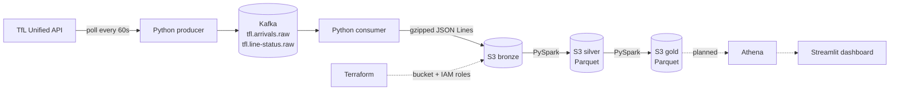

# tfl-streaming-pipeline

[](https://github.com/Muhammad234871/tfl-streaming-pipeline/actions/workflows/ci.yml)

A data pipeline for London transport. It streams live train arrival predictions and line
disruptions for the Tube, DLR, Elizabeth line and Overground from the
[TfL Unified API](https://api.tfl.gov.uk) through **Kafka** into an **S3 data lake**, then uses
**PySpark** to turn the raw data into clean **silver** tables and analytics-ready **gold** tables
(delay minutes per line, busiest stations, time between trains). The AWS infrastructure is
provisioned by **Terraform**.

**Scale:** about **8,600 events per poll**, polled every minute, up to about **12 million events per day**.
Gzip compression reduces the raw JSON about **17×** on disk; for one day, 43 MB of bronze
becomes 18.6 MiB of silver Parquet and a few kilobytes of gold.

## Architecture



| Component | What it does |
|---|---|
| **Producer** (`producer.py`) | Polls TfL every 60 seconds, wraps each record in an envelope (`poll_id`, `ingested_at`, `source`, `data`), and publishes it to Kafka keyed by line |
| **Kafka** (`docker-compose.yml`) | Single-node broker in KRaft mode (no ZooKeeper), 3 partitions per topic, 72-hour retention, plus Kafka UI |
| **Consumer** (`consumer.py`) | Reads both topics, buffers messages, and writes gzipped JSON Lines files to bronze, partitioned by ingestion hour |
| **Sinks** (`sinks.py`) | Write files to the lake: an S3 bucket or a local folder, chosen by one setting (`LAKE_URI`) without changing the consumer |
| **Spark jobs** (`jobs/silver/`, `jobs/gold/`) | Batch jobs, one day at a time: bronze → silver (clean, typed, deduplicated) → gold (aggregated answers) |
| **Infrastructure** (`infra/`) | Terraform for the S3 bucket (private, tagged, raw bronze expires after 30 days) and two least-privilege IAM roles: one for the consumer, one for the Spark jobs |

## Data model (medallion architecture)

| Layer | Format | Partitioned by | Written by | Purpose |
|---|---|---|---|---|
| **Bronze** | gzipped JSON Lines | `dt`, `hour` (ingestion time, UTC) | consumer (streaming) | faithful raw copy, replayable; duplicates allowed |
| **Silver** | Parquet | `dt` | Spark | clean, typed, deduplicated rows |
| **Gold** | Parquet | `dt` | Spark | small aggregated tables that answer questions |

```
s3://<bucket>/bronze/arrivals/dt=2026-10-21/hour=13/part-20261021T131041Z-1a2b3c4d.jsonl.gz
s3://<bucket>/silver/arrivals/dt=2026-10-21/part-00000-....snappy.parquet
s3://<bucket>/gold/line_headways/dt=2026-10-21/part-00000-....snappy.parquet
```

### Silver tables

| Table | Grain (one row per…) | Main transformations |
|---|---|---|
| `silver/arrivals` | prediction (train X expected at station Y at time Z) as seen in one poll | flatten the envelope, `snake_case` names, cast timestamps, **derive `time_to_station_s`** (TfL omits it with `count=-1`), placeholder `vehicle_id` (`""`, `"000"`) → NULL with the row kept, drop rows without line/station/arrival time, **deduplicate on the full row** |
| `silver/line_status` | line × status × poll | flatten, **`explode_outer`** the `lineStatuses` list (a line can have several statuses at once), keep severity, description, reason and disruption category |

Deduplication uses the full row, not `(poll_id, id)`: exploring the data showed that the DLR
reuses one prediction `id` for several different trains, so that key would have silently deleted
about 7% of the rows. See [docs/data_exploration.md](docs/data_exploration.md).

### Gold tables

| Table | Grain | Metrics | Question it answers |
|---|---|---|---|
| `gold/line_status_daily` | line × day × status | `status_minutes`, `observed_minutes`, `pct_of_observed` | How many minutes was each line delayed or suspended? |
| `gold/station_hourly` | station × day × hour | `train_arrivals`, `line_count`, `lines` | Which stations are busiest, and when? |
| `gold/line_headways` | line × station × platform × day × hour | `trains`, `avg_headway_min`, `median_headway_min`, `max_headway_min` | How often do trains really come, and where are the long gaps? |

### Modelling rules and caveats

Gold tables rest on a few explicit modelling choices:

| Rule | Value | Where |
|---|---|---|
| One poll ≈ one minute of observation | poll interval 60 s | `line_status_daily` |
| A prediction this close counts as the train **arriving** | ≤ 60 s | `jobs/gold/arrival_events.py` |
| Sightings of the same train at the same platform closer than this are **one arrival** | 10 min | `jobs/gold/arrival_events.py` |
| Gaps longer than this are **gaps in data collection**, not in the service | 30 min | `jobs/gold/line_headways.py` |

- Trains without a `vehicle_id` (mostly the DLR) are identified by destination + prediction ID.
- Results describe the time the pipeline was collecting: `observed_minutes` makes that explicit
  for line status, and partially collected hours show fewer trains than really ran.
- A line with several simultaneous statuses can exceed 100% across its statuses.
- The median uses `percentile_approx`, which returns a real data value rather than an
  interpolated one.

## Design decisions

**Ingestion**
- **At-least-once delivery.** The consumer commits Kafka offsets only *after* files are
  written. A crash or a failed S3 upload can replay messages (duplicates, removed in silver)
  but never lose them.
- **Idempotent, safe producer.** `acks=all` and `enable.idempotence=true`, so network retries
  never create duplicates inside Kafka. A delivery callback counts failed messages, and a full
  local queue (Kafka down) pauses the producer instead of crashing it.
- **The raw payload is kept untouched.** Each record is wrapped in an envelope, so the bronze
  layer is a faithful copy of the source and any later transformation can be replayed.
- **Partitioned by ingestion time, in UTC.** Hive-style `dt=/hour=` folders let Spark and
  Athena skip irrelevant data, and a delayed flush still lands each event in the correct hour.
  UTC avoids broken hours when London changes between GMT and BST.
- **Kafka key = `lineId`.** All events for a line go to the same partition, in order.
- **Batched files, not one file per message.** Messages are flushed every 50,000 records or
  5 minutes, which avoids the small-files problem in Spark and Athena.
- **Fault isolation and graceful shutdown.** If one transport mode fails the others are still
  collected; TfL rate limits and server errors are retried with backoff. On SIGINT/SIGTERM the
  producer flushes and the consumer writes and commits its remaining buffer.

**Batch processing (Spark)**
- **Idempotent jobs.** Each job processes one day (`--dt`) and writes with dynamic partition
  overwrite: re-running a day replaces only that day's partition, so retries and backfills are
  safe and other days are never touched.
- **Partition pruning.** Jobs read the dataset root and filter on `dt`, so Spark opens only
  that day's files while keeping `dt` as a column.
- **Schema contract.** Silver selects columns explicitly instead of `data.*`, so a new field in
  the API cannot silently change downstream tables.
- **One file per partition.** Writes repartition by `dt`, avoiding many tiny Parquet files.
- **Same code, local or cloud.** `--lake ./data/lake` or `--lake s3a://<bucket>`; the S3A
  connector and the standard AWS credential chain are configured in `jobs/common.py`.
- **Testable transformations.** Each job's logic lives in a pure `transform(df) -> df` function,
  separate from reading and writing, and is unit-tested with tiny DataFrames.

**Infrastructure and security**
- **Infrastructure as code.** The bucket and IAM roles are created by Terraform, never by
  hand: public access is blocked, every resource is tagged, and a lifecycle rule deletes raw
  bronze after 30 days to control cost (silver and gold are kept).
- **Least privilege per layer.** The consumer role can only `s3:PutObject` under `bronze/`.
  The Spark role can read all layers and write/delete only `silver/` and `gold/`, so batch
  jobs cannot modify raw data. Both were verified with negative tests (denied writes,
  listing and deletes).
- **No long-lived AWS keys.** Local development uses `aws login` (temporary credentials, up to
  12 hours) and roles are *assumed*; nothing secret is stored in the repo.

## Run it locally

Prerequisites: Python 3.12, Docker, and Java 17+ for Spark.

```bash
# 1. Install
python -m venv .venv && source .venv/bin/activate
pip install -e ".[dev,spark]"

# 2. Start Kafka (Kafka UI at http://localhost:8080)
docker compose up -d

# 3. Run the producer and consumer in two terminals (writes to data/lake/bronze/)
python -m tfl_pipeline.producer
FLUSH_MAX_SECONDS=60 python -m tfl_pipeline.consumer

# 4. Build silver, then gold, for one day
python -m tfl_pipeline.jobs.silver.arrivals          --dt 2026-10-21
python -m tfl_pipeline.jobs.silver.line_status       --dt 2026-10-21
python -m tfl_pipeline.jobs.gold.line_status_daily   --dt 2026-10-21
python -m tfl_pipeline.jobs.gold.station_hourly      --dt 2026-10-21
python -m tfl_pipeline.jobs.gold.line_headways       --dt 2026-10-21
```

All settings have sensible defaults and can be overridden with environment variables; see
[`.env.example`](.env.example). A free [TfL app key](https://api-portal.tfl.gov.uk) is optional
and raises the API rate limit. For quieter Spark logs, `export SPARK_CONF_DIR=$PWD/conf`.

## Run against AWS

Prerequisites: an AWS account, [AWS CLI](https://docs.aws.amazon.com/cli/latest/userguide/getting-started-install.html)
v2.32+ and [Terraform](https://developer.hashicorp.com/terraform/install) 1.16+.

```bash
# 1. Sign in (temporary credentials, no access keys)
aws login --remote

# 2. Create the bucket and the two IAM roles
cd infra
terraform init
terraform plan     # always review the plan before applying
terraform apply
terraform output   # lake_bucket_name, consumer_role_arn, spark_jobs_role_arn

# 3. CLI profiles that assume the least-privilege roles
aws configure set role_arn "$(terraform output -raw consumer_role_arn)" --profile tfl-consumer
aws configure set source_profile default --profile tfl-consumer
aws configure set region eu-north-1 --profile tfl-consumer

aws configure set role_arn "$(terraform output -raw spark_jobs_role_arn)" --profile tfl-spark
aws configure set source_profile default --profile tfl-spark
aws configure set region eu-north-1 --profile tfl-spark
# Spark's Java SDK reads the role's credentials through the CLI:
aws configure set credential_process "aws configure export-credentials --profile tfl-spark --format process" --profile tfl-spark-process
aws configure set region eu-north-1 --profile tfl-spark-process
cd ..

# 4. Stream into S3 bronze with the consumer role
AWS_PROFILE=tfl-consumer LAKE_URI=s3://<bucket-name> python -m tfl_pipeline.consumer

# 5. Run the Spark jobs on S3 with the Spark role
export AWS_PROFILE=tfl-spark-process
python -m tfl_pipeline.jobs.silver.arrivals --dt 2026-10-21 --lake s3a://<bucket-name>
# ...and the other four jobs, silver before gold
```

`LAKE_URI` (consumer) accepts `s3://bucket[/prefix]` or a local path; Spark jobs use `s3a://`
for S3. The first Spark run downloads the S3A connector (`hadoop-aws`, matching PySpark's
bundled Hadoop), about 675 MB, cached afterwards.

## Testing and CI

```bash
ruff check .            # lint
ruff format --check .   # formatting
pytest -v               # 14 unit tests, including Spark transformations

cd infra
terraform fmt -check -recursive   # Terraform formatting
terraform validate                # Terraform syntax and references
```

GitHub Actions runs two jobs on every pull request and on every push to `main`: `test`
(Python 3.12 + Java 21, ruff and pytest) and `terraform` (fmt + validate, with no AWS access).
Branch protection blocks merging until both pass.

The Spark tests build tiny DataFrames with explicit schemas and check the rules that matter,
for example: placeholder vehicle IDs become NULL without dropping rows, exact replays are
removed while DLR trains sharing an ID are kept, one train seen in two polls counts as one
arrival, and collection gaps are excluded from headways. They need neither Kafka, the TfL API
nor AWS.

## Project structure

```
src/tfl_pipeline/
  config.py            settings from environment variables, topic names
  tfl_client.py        TfL API client with retries and timeouts
  events.py            event envelope and lake partitioning
  producer.py          TfL -> Kafka
  consumer.py          Kafka -> bronze lake
  sinks.py             file writers: local folder or S3
  jobs/
    common.py          Spark session (UTC, dynamic overwrite, S3A) and read/write helpers
    silver/            arrivals.py, line_status.py
    gold/              arrival_events.py (shared rules), line_status_daily.py,
                       station_hourly.py, line_headways.py
infra/                 Terraform: S3 bucket, consumer and Spark IAM roles
tests/                 unit tests (conftest.py holds the shared Spark fixtures)
docs/                  data exploration notes
conf/                  log4j2.properties for quieter local Spark logs
docker-compose.yml     local Kafka + Kafka UI
```

## Roadmap

| Phase | What | Status |
|---|---|---|
| 1 | Ingestion: TfL → Kafka → bronze lake | ✅ Done |
| – | CI with GitHub Actions, branch protection | ✅ Done |
| 2 | S3 data lake with Terraform; least-privilege IAM; Terraform checks in CI | ✅ Done |
| 3 | PySpark: bronze → silver → gold, Spark tests in CI, jobs running on S3 | ✅ Done |
| 4 | Glue Data Catalog and Athena | ⏳ Next |
| 5 | Airflow orchestration and data quality checks | Planned |
| 6 | Streamlit dashboard (live line status, delays, busiest stations) | Planned |
| 7 | Docker images, 24/7 deployment, CD | Planned |
