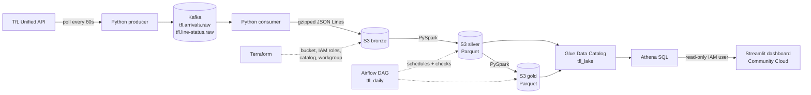
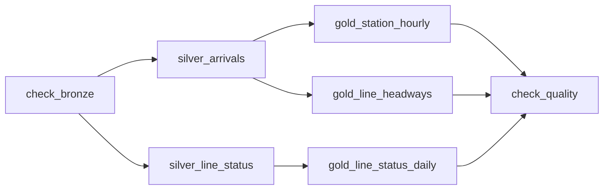

# tfl-streaming-pipeline

[](https://github.com/Muhammad234871/tfl-streaming-pipeline/actions/workflows/ci.yml)

A data pipeline for London transport. It streams live train arrival predictions and line
disruptions for the Tube, DLR, Elizabeth line and Overground from the
[TfL Unified API](https://api.tfl.gov.uk) through **Kafka** into an **S3 data lake**, then uses
**PySpark** to turn the raw data into clean **silver** tables and analytics-ready **gold** tables
(delay minutes per line, busiest stations, time between trains). **Apache Airflow** runs the
batch jobs every day in dependency order, with retries, backfills and data quality checks. Every
table is registered in the **AWS Glue Data Catalog** and can be queried with plain SQL in
**Amazon Athena**. A public **Streamlit** dashboard reads the gold tables through Athena with a
read-only IAM user. The AWS infrastructure is provisioned by **Terraform**.

**Live dashboard:** [tfl-london-network.streamlit.app](https://tfl-london-network.streamlit.app/)

**Scale:** about **8,600 events per poll**, polled every minute, up to about **12 million events per day**.
Gzip compression reduces the raw JSON about **17×** on disk; for one day, 43 MB of bronze
becomes 18.6 MiB of silver Parquet and a few kilobytes of gold.

## Architecture



| Component | What it does |
|---|---|
| **Producer** (`producer.py`) | Polls TfL every 60 seconds, wraps each record in an envelope (`poll_id`, `ingested_at`, `source`, `data`), and publishes it to Kafka keyed by line |
| **Kafka** (`docker-compose.yml`) | Single-node broker in KRaft mode (no ZooKeeper), 3 partitions per topic, 72-hour retention, plus Kafka UI |
| **Consumer** (`consumer.py`) | Reads both topics, buffers messages, and writes gzipped JSON Lines files to bronze, partitioned by ingestion hour |
| **Sinks** (`sinks.py`) | Write files to the lake: an S3 bucket or a local folder, chosen by one setting (`LAKE_URI`) without changing the consumer |
| **Spark jobs** (`jobs/silver/`, `jobs/gold/`) | Batch jobs, one day at a time: bronze → silver (clean, typed, deduplicated) → gold (aggregated answers) |
| **Orchestration** (`dags/tfl_daily.py`) | Airflow DAG that, once a day, checks bronze exists, runs the five Spark jobs in dependency order and finishes with data quality checks |
| **Catalog and SQL** (`infra/athena.tf`, `sql/`) | Glue database `tfl_lake` with all silver and gold tables (partition projection on `dt`), and an Athena workgroup with a 1 GB per-query scan limit |
| **Dashboard** (`dashboard/`) | Streamlit app with Altair charts: disruptions by line, arrivals per hour, busiest stations, service frequency. Reads local Parquet or Athena, chosen by one setting |
| **Infrastructure** (`infra/`) | Terraform for the S3 bucket (private, tagged, raw bronze expires after 30 days, query results after 7), two least-privilege IAM roles (consumer and Spark jobs), a read-only IAM user for the dashboard, and the catalog and workgroup |

## Data model (medallion architecture)

| Layer | Format | Partitioned by | Written by | Purpose |
|---|---|---|---|---|
| **Bronze** | gzipped JSON Lines | `dt`, `hour` (ingestion time, UTC) | consumer (streaming) | faithful raw copy, replayable; duplicates allowed |
| **Silver** | Parquet | `dt` | Spark | clean, typed, deduplicated rows |
| **Gold** | Parquet | `dt` | Spark | small aggregated tables that answer questions |

```
s3://<bucket>/bronze/arrivals/dt=2026-10-21/hour=13/part-20261021T131041Z-1a2b3c4d.jsonl.gz
s3://<bucket>/silver/arrivals/dt=2026-10-21/part-00000-....snappy.parquet
s3://<bucket>/gold/line_headways/dt=2026-10-21/part-00000-....snappy.parquet
```

### Silver tables

| Table | Grain (one row per…) | Main transformations |
|---|---|---|
| `silver/arrivals` | prediction (train X expected at station Y at time Z) as seen in one poll | flatten the envelope, `snake_case` names, cast timestamps, **derive `time_to_station_s`** (TfL omits it with `count=-1`), placeholder `vehicle_id` (`""`, `"000"`) → NULL with the row kept, drop rows without line/station/arrival time, **deduplicate on the full row** |
| `silver/line_status` | line × status × poll | flatten, **`explode_outer`** the `lineStatuses` list (a line can have several statuses at once), keep severity, description, reason and disruption category |

Deduplication uses the full row, not `(poll_id, id)`: exploring the data showed that the DLR
reuses one prediction `id` for several different trains, so that key would have silently deleted
about 7% of the rows. See [docs/data_exploration.md](docs/data_exploration.md).

### Gold tables

| Table | Grain | Metrics | Question it answers |
|---|---|---|---|
| `gold/line_status_daily` | line × day × status | `status_minutes`, `observed_minutes`, `pct_of_observed` | How many minutes was each line delayed or suspended? |
| `gold/station_hourly` | station × day × hour | `train_arrivals`, `line_count`, `lines` | Which stations are busiest, and when? |
| `gold/line_headways` | line × station × platform × day × hour | `trains`, `avg_headway_min`, `median_headway_min`, `max_headway_min` | How often do trains really come, and where are the long gaps? |

### Modelling rules and caveats

Gold tables rest on a few explicit modelling choices:

| Rule | Value | Where |
|---|---|---|
| One poll ≈ one minute of observation | poll interval 60 s | `line_status_daily` |
| A prediction this close counts as the train **arriving** | ≤ 60 s | `jobs/gold/arrival_events.py` |
| Sightings of the same train at the same platform closer than this are **one arrival** | 10 min | `jobs/gold/arrival_events.py` |
| Gaps longer than this are **gaps in data collection**, not in the service | 30 min | `jobs/gold/line_headways.py` |

- Trains without a `vehicle_id` (mostly the DLR) are identified by destination + prediction ID.
- Results describe the time the pipeline was collecting: `observed_minutes` makes that explicit
  for line status, and partially collected hours show fewer trains than really ran.
- A line with several simultaneous statuses can exceed 100% across its statuses.
- The median uses `percentile_approx`, which returns a real data value rather than an
  interpolated one.

### Known limitations

Found by sense-checking the gold tables in Athena against how the network really runs:

- **Low-frequency services sit at the 30-minute limit.** Some Elizabeth line stations west of
  London have a real 30-minute off-peak service, and several Tube gaps land just under 30
  minutes, so genuine long gaps may be dropped as "collection gaps". A per-line limit, or
  checking whether polls were actually missing during the gap, would be more accurate.
- **Occasional double counting.** A few platforms show a median headway of 0 minutes, which is
  physically impossible: trains without a `vehicle_id` can get a new prediction ID between
  polls and be counted as two arrivals. Merging events at the same platform within a minute or
  two would fix it.
- **Partial days and hours.** Collection has not yet run for a full 24 hours, so totals cover
  only the observed time.

## Query with SQL (Athena)

All silver and gold tables are registered in the Glue Data Catalog database **`tfl_lake`** and
can be queried in Athena using the **`tfl`** workgroup (results are written to
`athena-results/` and expire after 7 days; queries scanning more than 1 GB are cancelled).

| Table | Source |
|---|---|
| `silver_arrivals`, `silver_line_status` | `silver/<table>/dt=…/` |
| `gold_line_status_daily`, `gold_station_hourly`, `gold_line_headways` | `gold/<table>/dt=…/` |

Tables use **partition projection** on `dt`: Athena computes the partitions from the folder
pattern, so new days are queryable immediately, with no crawler or `MSCK REPAIR TABLE`.
Filter on `dt` (a string, e.g. `dt = '2026-10-21'`) so that only that day's files are read.
The tables are defined once in Terraform with `for_each` over a map of table names, paths and
column types.

Example queries live in [`sql/`](sql/):

| Query | Question | Sample result (2026-10-21) |
|---|---|---|
| [`delay_minutes_by_line.sql`](sql/delay_minutes_by_line.sql) | Which lines were disrupted, and for how long? | Victoria: minor delays for 100% of the observed time; Central 35% |
| [`busiest_stations.sql`](sql/busiest_stations.sql) | Which stations had the most train arrivals? | King's Cross St. Pancras 330, Euston 255, Waterloo 240 |
| [`longest_waits.sql`](sql/longest_waits.sql) | Where were the longest gaps between Tube trains? | Central line west (Ruislip Gardens, Hanger Lane) and Piccadilly at Northfields, up to ~30 minutes |

A gold-table query scans only kilobytes (for example 0.87 KB in about 0.4 seconds), so it costs
a tiny fraction of a cent.

## Orchestration (Airflow)

The `tfl_daily` DAG ([`dags/tfl_daily.py`](dags/tfl_daily.py)) runs once a day for the day that
has just ended. Each task runs one job with `--dt {{ ds }}` (the run's logical date):



| Task | What it does |
|---|---|
| `check_bronze` | Exits with code 99 if there is no bronze data for the day, which **skips** the whole run (a day with nothing collected is not an error) |
| silver and gold tasks | The Spark jobs, in dependency order; retried twice, 5 minutes apart |
| `check_quality` | Fails the run if any table is empty, keys are NULL, duplicates appear or metrics are out of range; known issues are logged as warnings. Not retried, as a data problem won't fix itself |

So a run's colour means something: **green** = processed and checked, **skipped** = no data
was collected that day, **red** = a real problem to investigate.

- **Backfills.** Because every job is idempotent, a whole range can be re-run safely, e.g.
  `airflow backfill create --dag-id tfl_daily --from-date 2026-10-15 --to-date 2026-10-21 --max-active-runs 1`.
- **Local or cloud.** The same DAG runs on the local lake or on S3, chosen by environment
  (`TFL_LAKE=s3a://<bucket>` and `AWS_PROFILE=tfl-spark-process`); tasks then use the
  least-privilege Spark role.
- **Sized for a laptop.** `max_active_runs=1` and `max_active_tasks=1` keep it to one Spark job
  at a time; on a cluster the two gold branches could run in parallel.
- **Isolated environments.** Airflow runs in its own virtualenv (installed with the official
  constraints file); tasks call the project's virtualenv, so their dependencies never clash.

## Dashboard

**Live:** [tfl-london-network.streamlit.app](https://tfl-london-network.streamlit.app/), hosted on Streamlit Community Cloud ([`dashboard/app.py`](dashboard/app.py)).


Pick a day and the page shows that day's gold data:

| Section | Gold table | What it answers |
|---|---|---|
| KPI tiles | all three | Train arrivals, stations served, lines with a disruption |
| Non-good status by line | `line_status_daily` | Which lines were disrupted, how badly and for how long (overnight closures left out) |
| Arrivals per hour | `station_hourly` | The shape of the day: overnight closure, morning peak |
| Busiest stations | `station_hourly` | Most train arrivals; a station's Tube, rail and Elizabeth line entries are merged by name |
| Time between trains | `line_headways` | Median minutes between trains per line (platform-hours with 5+ trains) |

**How it gets data** ([`dashboard/data.py`](dashboard/data.py)):

- **One switch, two backends.** `DASHBOARD_SOURCE=local` reads the Parquet files in
  `data/lake/gold/`; `DASHBOARD_SOURCE=athena` queries the same tables in S3 through Athena with
  [awswrangler](https://github.com/aws/aws-sdk-pandas). The page code doesn't know which one
  it's using.
- **Safe SQL.** The day is passed as a query parameter (`WHERE dt = :dt`), never formatted into
  the SQL; table names, which can't be parameters, are checked against an allowlist.
- **Read-only queries.** `ctas_approach=False` reads Athena's result file directly instead of
  creating temporary tables, so the app needs no Glue write or S3 delete permissions.
- **Caching.** `st.cache_data` keeps each day's results for an hour and the list of days for
  10 minutes. Athena is queried once per day viewed, not on every click, so a public app costs
  almost nothing; the workgroup's 1 GB scan limit caps any single query.
- **Configured by environment.** Locally the app uses an AWS CLI profile; on Streamlit Cloud the
  access key and `DASHBOARD_SOURCE` are app secrets, exposed as environment variables. No code
  changes between the two.

### Security: least privilege, verified

The deployed app uses the IAM user `tfl-dashboard` ([`infra/dashboard.tf`](infra/dashboard.tf)).
It can run queries in the `tfl` workgroup, read the `gold_*` table definitions and gold files,
and write query results to `athena-results/`; nothing else. Tested with the user's own key:

| Attempt | Result |
|---|---|
| Run the dashboard (Athena queries on gold) | ✅ Works |
| List `bronze/`, `silver/` or the bucket root | ❌ AccessDenied |
| Download a silver file, even with its exact key | ❌ 403 |
| Write to `gold/` | ❌ AccessDenied |
| Query `silver_arrivals` in Athena | ❌ `TABLE_NOT_FOUND` (Glue access is limited to `gold_*`) |
| Use the `primary` workgroup (no scan limit) | ❌ AccessDenied |

The access key is created with the AWS CLI, not Terraform, so the secret never appears in the
Terraform state. It lives only in a local CLI profile and in Streamlit's secrets.

### Dashboard limitations

- **Few days so far.** It shows the days collected and processed in S3; more appear as the
  pipeline runs.
- **New days appear within 10 minutes** of the DAG finishing, because the day list is cached.
- **Station names** are merged by removing suffixes like " Underground Station"; a proper fix
  needs a NaPTAN station lookup table.
- **Cold start.** The free tier sleeps after a few days without visitors; the first visit
  wakes it in about a minute, and the first Athena queries take about 15 seconds.

## Design decisions

**Ingestion**
- **At-least-once delivery.** The consumer commits Kafka offsets only *after* files are
  written. A crash or a failed S3 upload can replay messages (duplicates, removed in silver)
  but never lose them.
- **Idempotent, safe producer.** `acks=all` and `enable.idempotence=true`, so network retries
  never create duplicates inside Kafka. A delivery callback counts failed messages, and a full
  local queue (Kafka down) pauses the producer instead of crashing it.
- **The raw payload is kept untouched.** Each record is wrapped in an envelope, so the bronze
  layer is a faithful copy of the source and any later transformation can be replayed.
- **Partitioned by ingestion time, in UTC.** Hive-style `dt=/hour=` folders let Spark and
  Athena skip irrelevant data, and a delayed flush still lands each event in the correct hour.
  UTC avoids broken hours when London changes between GMT and BST.
- **Kafka key = `lineId`.** All events for a line go to the same partition, in order.
- **Batched files, not one file per message.** Messages are flushed every 50,000 records or
  5 minutes, which avoids the small-files problem in Spark and Athena.
- **Fault isolation and graceful shutdown.** If one transport mode fails the others are still
  collected; TfL rate limits and server errors are retried with backoff. On SIGINT/SIGTERM the
  producer flushes and the consumer writes and commits its remaining buffer.

**Batch processing (Spark)**
- **Idempotent jobs.** Each job processes one day (`--dt`) and writes with dynamic partition
  overwrite: re-running a day replaces only that day's partition, so retries and backfills are
  safe and other days are never touched.
- **Partition pruning.** Jobs read the dataset root and filter on `dt`, so Spark opens only
  that day's files while keeping `dt` as a column.
- **Schema contract.** Silver selects columns explicitly instead of `data.*`, so a new field in
  the API cannot silently change downstream tables.
- **One file per partition.** Writes repartition by `dt`, avoiding many tiny Parquet files.
- **Same code, local or cloud.** `--lake ./data/lake` or `--lake s3a://<bucket>`; the S3A
  connector and the standard AWS credential chain are configured in `jobs/common.py`.
- **Testable transformations.** Each job's logic lives in a pure `transform(df) -> df` function,
  separate from reading and writing, and is unit-tested with tiny DataFrames.

**Infrastructure and security**
- **Infrastructure as code.** The bucket, IAM roles, Glue tables and Athena workgroup are
  created by Terraform, never by hand: public access is blocked, every resource is tagged, and
  lifecycle rules delete raw bronze after 30 days and query results after 7 (silver and gold
  are kept). Refactoring the first Glue table into `for_each` used a `moved` block, so nothing
  was destroyed.
- **Cost guardrails.** Athena queries are capped at 1 GB scanned each, and Parquet plus
  partition projection keep typical queries to kilobytes.
- **Least privilege per layer.** The consumer role can only `s3:PutObject` under `bronze/`.
  The Spark role can read all layers and write/delete only `silver/` and `gold/`, so batch
  jobs cannot modify raw data. Both were verified with negative tests (denied writes,
  listing and deletes).
- **No long-lived AWS keys.** Local development uses `aws login` (temporary credentials, up to
  12 hours) and roles are *assumed*; nothing secret is stored in the repo.

## Run it locally

Prerequisites: Python 3.12, Docker, and Java 17+ for Spark.

```bash
# 1. Install
python -m venv .venv && source .venv/bin/activate
pip install -e ".[dev,spark]"

# 2. Start Kafka (Kafka UI at http://localhost:8080)
docker compose up -d

# 3. Run the producer and consumer in two terminals (writes to data/lake/bronze/)
python -m tfl_pipeline.producer
FLUSH_MAX_SECONDS=60 python -m tfl_pipeline.consumer

# 4. Build silver, then gold, for one day
python -m tfl_pipeline.jobs.silver.arrivals          --dt 2026-10-21
python -m tfl_pipeline.jobs.silver.line_status       --dt 2026-10-21
python -m tfl_pipeline.jobs.gold.line_status_daily   --dt 2026-10-21
python -m tfl_pipeline.jobs.gold.station_hourly      --dt 2026-10-21
python -m tfl_pipeline.jobs.gold.line_headways       --dt 2026-10-21

# 5. Open the dashboard on the local gold tables (http://localhost:8501)
pip install -e ".[dashboard]"
streamlit run dashboard/app.py
```

All settings have sensible defaults and can be overridden with environment variables; see
[`.env.example`](.env.example). A free [TfL app key](https://api-portal.tfl.gov.uk) is optional
and raises the API rate limit. For quieter Spark logs, `export SPARK_CONF_DIR=$PWD/conf`.

### Run the batch jobs with Airflow

Airflow 3.3 runs in its own virtualenv, outside the repo:

```bash
uv venv --python 3.12 ~/airflow-venv
uv pip install --python ~/airflow-venv/bin/python "apache-airflow==3.3.2" \
  --constraint "https://raw.githubusercontent.com/apache/airflow/constraints-3.3.2/constraints-3.12.txt"

export AIRFLOW_HOME=~/airflow
export AIRFLOW__CORE__DAGS_FOLDER="$PWD/dags"
export AIRFLOW__CORE__LOAD_EXAMPLES=False
export AIRFLOW__API__PORT=8081                       # 8080 is taken by Kafka UI
export AIRFLOW__API__BASE_URL=http://localhost:8081  # tasks reach the API server here

source ~/airflow-venv/bin/activate
airflow standalone                       # UI at http://localhost:8081 (admin password is printed)
airflow dags test tfl_daily 2026-10-21   # in another terminal: run one day end to end
```

## Run against AWS

Prerequisites: an AWS account, [AWS CLI](https://docs.aws.amazon.com/cli/latest/userguide/getting-started-install.html)
v2.32+ and [Terraform](https://developer.hashicorp.com/terraform/install) 1.16+.

```bash
# 1. Sign in (temporary credentials, no access keys)
aws login --remote

# 2. Create the bucket, the two IAM roles, the Glue catalog and the Athena workgroup
cd infra
terraform init
terraform plan     # always review the plan before applying
terraform apply
terraform output   # bucket name, role ARNs, Athena workgroup, Glue database

# 3. CLI profiles that assume the least-privilege roles
aws configure set role_arn "$(terraform output -raw consumer_role_arn)" --profile tfl-consumer
aws configure set source_profile default --profile tfl-consumer
aws configure set region eu-north-1 --profile tfl-consumer

aws configure set role_arn "$(terraform output -raw spark_jobs_role_arn)" --profile tfl-spark
aws configure set source_profile default --profile tfl-spark
aws configure set region eu-north-1 --profile tfl-spark
# Spark's Java SDK reads the role's credentials through the CLI:
aws configure set credential_process "aws configure export-credentials --profile tfl-spark --format process" --profile tfl-spark-process
aws configure set region eu-north-1 --profile tfl-spark-process
cd ..

# 4. Stream into S3 bronze with the consumer role
AWS_PROFILE=tfl-consumer LAKE_URI=s3://<bucket-name> python -m tfl_pipeline.consumer

# 5. Run the Spark jobs on S3 with the Spark role
export AWS_PROFILE=tfl-spark-process
python -m tfl_pipeline.jobs.silver.arrivals --dt 2026-10-21 --lake s3a://<bucket-name>
# ...and the other four jobs, silver before gold

# ...or let Airflow run the whole DAG on S3 (set the same variables for airflow standalone)
export TFL_LAKE=s3a://<bucket-name>
airflow dags test tfl_daily 2026-10-21

# 6. Dashboard on Athena with the read-only user (its access key is created once, outside Terraform)
aws iam create-access-key --user-name "$(terraform -chdir=infra output -raw dashboard_user_name)"
aws configure --profile tfl-dashboard      # paste the key; region eu-north-1
AWS_PROFILE=tfl-dashboard DASHBOARD_SOURCE=athena streamlit run dashboard/app.py
```

To deploy it, point Streamlit Community Cloud at `dashboard/app.py` on `main` and add
`DASHBOARD_SOURCE`, `AWS_ACCESS_KEY_ID`, `AWS_SECRET_ACCESS_KEY` and `AWS_DEFAULT_REGION` as
top-level secrets. It installs only `dashboard/requirements.txt`, not the whole pipeline.

`LAKE_URI` (consumer) accepts `s3://bucket[/prefix]` or a local path; Spark jobs use `s3a://`
for S3. The first Spark run downloads the S3A connector (`hadoop-aws`, matching PySpark's
bundled Hadoop), about 675 MB, cached afterwards.

## Testing and CI

```bash
ruff check .            # lint
ruff format --check .   # formatting
pytest -v               # 14 unit tests, including Spark transformations

pytest tests/test_dags.py -v   # in the Airflow virtualenv: DAG structure tests

cd infra
terraform fmt -check -recursive   # Terraform formatting
terraform validate                # Terraform syntax and references
```

GitHub Actions runs three jobs on every pull request and on every push to `main`: `test`
(Python 3.12 + Java 21, ruff and pytest), `dags` (Airflow 3.3.2 with its constraints, DAG
structure tests) and `terraform` (fmt + validate, with no AWS access). Branch protection blocks
merging until they pass.

The DAG tests load `dags/` and check that it imports without errors, has the expected tasks and
dependencies, passes `{{ ds }}` to every job, retries jobs but not checks, and keeps the
concurrency limits. They skip themselves where Airflow isn't installed.

The Spark tests build tiny DataFrames with explicit schemas and check the rules that matter,
for example: placeholder vehicle IDs become NULL without dropping rows, exact replays are
removed while DLR trains sharing an ID are kept, one train seen in two polls counts as one
arrival, and collection gaps are excluded from headways. They need neither Kafka, the TfL API
nor AWS.

## Project structure

```
src/tfl_pipeline/
  config.py            settings from environment variables, topic names
  tfl_client.py        TfL API client with retries and timeouts
  events.py            event envelope and lake partitioning
  producer.py          TfL -> Kafka
  consumer.py          Kafka -> bronze lake
  sinks.py             file writers: local folder or S3
  jobs/
    common.py          Spark session (UTC, dynamic overwrite, S3A) and read/write helpers
    silver/            arrivals.py, line_status.py
    gold/              arrival_events.py (shared rules), line_status_daily.py,
                       station_hourly.py, line_headways.py
    bronze_exists.py   "is there data for this day?" (exit 99 = skip the run)
    quality.py         data quality checks for one day of silver and gold
dags/                  Airflow DAG: tfl_daily.py
dashboard/             Streamlit app: app.py (page), charts.py (Altair charts),
                       data.py (local or Athena), requirements.txt (for Streamlit Cloud)
infra/                 Terraform: S3 bucket, IAM roles (main.tf, iam.tf),
                       Glue tables and Athena workgroup (athena.tf),
                       read-only dashboard user (dashboard.tf)
sql/                   example Athena queries on the gold tables
tests/                 unit tests (conftest.py holds the shared Spark fixtures)
docs/                  data exploration notes, dashboard screenshots (images/)
conf/                  log4j2.properties for quieter local Spark logs
docker-compose.yml     local Kafka + Kafka UI
```

## Roadmap

| Phase | What | Status |
|---|---|---|
| 1 | Ingestion: TfL → Kafka → bronze lake | ✅ Done |
| – | CI with GitHub Actions, branch protection | ✅ Done |
| 2 | S3 data lake with Terraform; least-privilege IAM; Terraform checks in CI | ✅ Done |
| 3 | PySpark: bronze → silver → gold, Spark tests in CI, jobs running on S3 | ✅ Done |
| 4 | Glue Data Catalog and Athena: all tables queryable with SQL, partition projection | ✅ Done |
| 5 | Airflow orchestration: daily DAG, data quality checks, skip on missing data, backfills, DAG tests in CI | ✅ Done |
| 6 | Streamlit dashboard on Athena, deployed publicly with a read-only IAM user | ✅ Done |
| 7 | Docker images, 24/7 deployment, CD | ⏳ Next |
