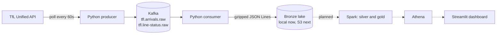

# tfl-streaming-pipeline

[](https://github.com/Muhammad234871/tfl-streaming-pipeline/actions/workflows/ci.yml)

A real-time data pipeline for London transport. It streams live train arrival predictions and
line disruptions for the Tube, DLR, Elizabeth line and Overground from the
[TfL Unified API](https://api.tfl.gov.uk) through **Kafka** into a partitioned **data lake**.

**Scale:** about **8,600 events per poll**, polled every minute, up to about **12 million events per day**.
Gzip compression reduces the raw JSON about **17×** on disk.

## Architecture



| Component | What it does |
|---|---|
| **Producer** (`producer.py`) | Polls TfL every 60 seconds, wraps each record in an envelope (`poll_id`, `ingested_at`, `source`, `data`), and publishes it to Kafka keyed by line |
| **Kafka** (`docker-compose.yml`) | Single-node broker in KRaft mode (no ZooKeeper), 3 partitions per topic, 72-hour retention, plus Kafka UI |
| **Consumer** (`consumer.py`) | Reads both topics, buffers messages, and writes gzipped JSON Lines files partitioned by ingestion hour |
| **Sink** (`sinks.py`) | Writes files to the lake. Local folder now; an S3 sink plugs in without changing the consumer |

Lake layout:
```
data/lake/bronze/arrivals/dt=2026-10-15/hour=10/part-20261015T133305Z-a534cca9.jsonl.gz
data/lake/bronze/line_status/dt=2026-10-15/hour=10/part-20261015T133305Z-666b6093.jsonl.gz
```

## Design decisions

- **At-least-once delivery.** The consumer commits Kafka offsets only *after* files are
  written. A crash can replay messages (duplicates, removed later in silver) but never lose them.
- **Idempotent, safe producer.** `acks=all` and `enable.idempotence=true`, so network retries
  never create duplicates inside Kafka. `lz4` compression and `linger.ms` batching keep it efficient.
- **The raw payload is kept untouched.** Each record is wrapped in an envelope, so the bronze
  layer is a faithful copy of the source and any later transformation can be replayed.
- **Partitioned by ingestion time, in UTC.** Hive-style `dt=/hour=` folders let Spark and
  Athena skip irrelevant data, and a delayed flush still lands each event in the correct hour.
  UTC avoids broken hours when London changes between GMT and BST.
- **Kafka key = `lineId`.** All events for a line go to the same partition, in order.
- **Batched files, not one file per message.** Messages are flushed every 50,000 records or
  5 minutes, which avoids the small-files problem in Spark and Athena.
- **Fault isolation.** If one transport mode fails, the others are still collected. TfL
  rate limits and server errors are retried with exponential backoff.
- **Graceful shutdown.** On Ctrl+C or `docker stop` (SIGINT/SIGTERM), the producer flushes
  queued messages and the consumer writes and commits its remaining buffer before exiting.

## Run it locally

Prerequisites: Python 3.12, Docker.

```bash
# 1. Install
python -m venv .venv && source .venv/bin/activate
pip install -e ".[dev]"

# 2. Start Kafka (Kafka UI at http://localhost:8080)
docker compose up -d

# 3. Run the producer and consumer in two terminals
python -m tfl_pipeline.producer
FLUSH_MAX_SECONDS=60 python -m tfl_pipeline.consumer
```

Files appear under `data/lake/bronze/`. All settings have sensible defaults and can be
overridden with environment variables; see [`.env.example`](.env.example). A free
[TfL app key](https://api-portal.tfl.gov.uk) is optional and raises the API rate limit.

## Testing and CI

```bash
ruff check .            # lint
ruff format --check .   # formatting
pytest -v               # unit tests
```

GitHub Actions runs all three on every pull request and on every push to `main`.
Unit tests use fixed sample data, so they need neither Kafka nor the TfL API.

## Project structure

```
src/tfl_pipeline/
  config.py       settings from environment variables, topic names
  tfl_client.py   TfL API client with retries and timeouts
  events.py       event envelope and lake partitioning
  producer.py     TfL -> Kafka
  consumer.py     Kafka -> bronze lake
  sinks.py        file writer (local now, S3 next)
tests/            unit tests
docs/             data exploration notes
docker-compose.yml  local Kafka + Kafka UI
```

See [docs/data_exploration.md](docs/data_exploration.md) for what the TfL data looks like and
the quirks found while exploring it.

## Roadmap

| Phase | What | Status |
|---|---|---|
| 1 | Ingestion: TfL → Kafka → bronze lake | ✅ Done |
| – | CI with GitHub Actions (ruff + pytest) | ✅ Done |
| 2 | S3 data lake, provisioned with Terraform | ⏳ Next |
| 3 | PySpark: bronze → silver (clean, deduplicate) → gold (KPIs) | Planned |
| 4 | Glue Data Catalog and Athena | Planned |
| 5 | Airflow orchestration and data quality checks | Planned |
| 6 | Streamlit dashboard (live line status, delays, busiest stations) | Planned |
| 7 | Docker images, 24/7 deployment, CD | Planned |
