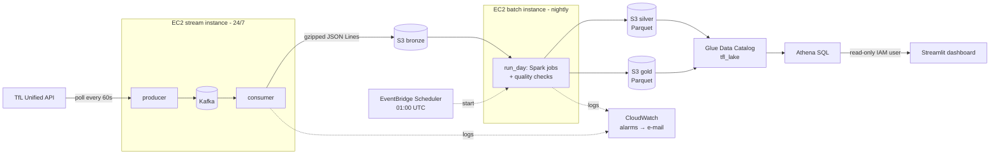
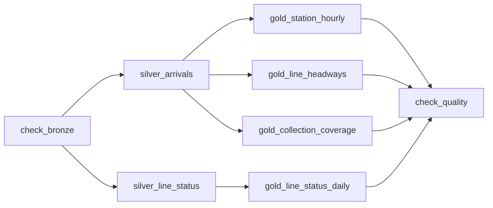
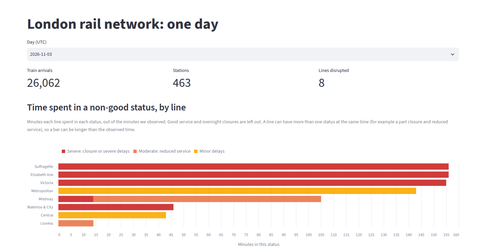
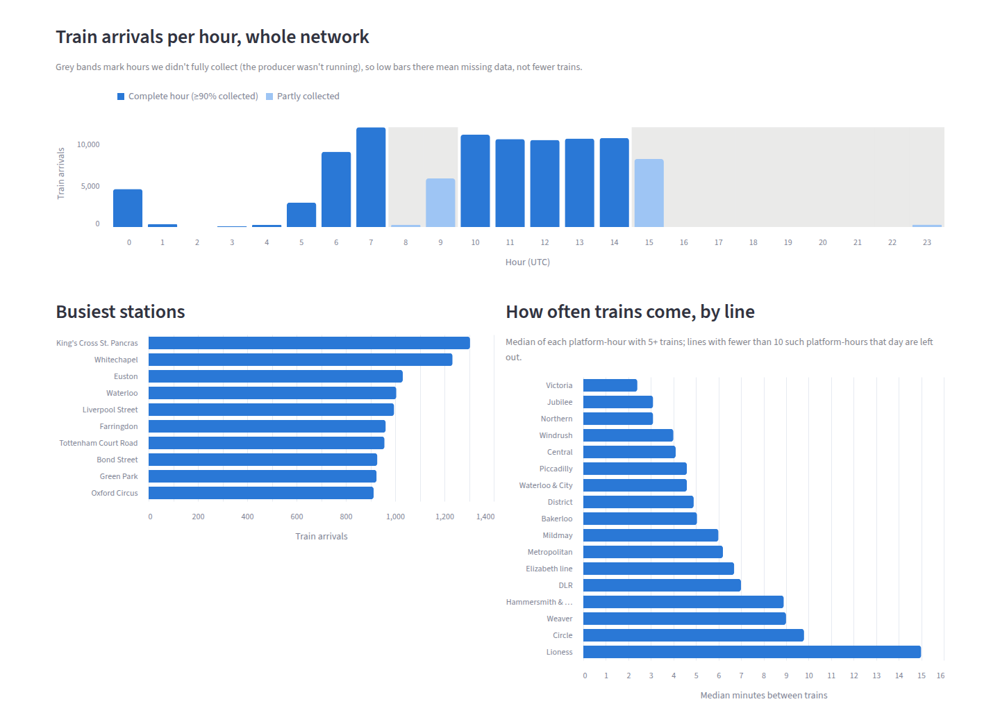

# tfl-streaming-pipeline

[](https://github.com/Muhammad234871/tfl-streaming-pipeline/actions/workflows/ci.yml)

A data pipeline for London transport, running 24/7 on AWS. It streams live train arrival
predictions and line disruptions for the Tube, DLR, Elizabeth line and Overground from the
[TfL Unified API](https://api.tfl.gov.uk) through **Kafka** into an **S3 data lake**, then uses
**PySpark** to turn the raw data into clean **silver** tables and analytics-ready **gold** tables
(delay minutes per line, busiest stations, time between trains, data coverage). Every table is
registered in the **AWS Glue Data Catalog** and can be queried with plain SQL in **Amazon
Athena**, and a public **Streamlit** dashboard reads the gold tables through Athena.

In production the stream runs in **Docker** on an always-on **EC2** instance, and a second
instance is started every night by **EventBridge Scheduler**, runs the daily Spark batch and
shuts itself down. **CloudWatch** alarms e-mail when data stops arriving or the batch fails, an
**AWS Budgets** action caps the cost, and every merge to `main` is built, pushed to **ECR** and
deployed by **GitHub Actions**. **Apache Airflow** orchestrates the same batch locally, with
backfills. All AWS infrastructure is provisioned by **Terraform**.

**Live dashboard:** [tfl-london-network.streamlit.app](https://tfl-london-network.streamlit.app/)

**Scale:** about **8,600 events per poll**, polled every minute, up to about **12 million events per day**.
Gzip compression reduces the raw JSON about **17×** on disk; for one day, 43 MB of bronze
becomes 18.6 MiB of silver Parquet and a few kilobytes of gold.

## Results: the first complete days (6–8 November 2026)

Since 6 November the pipeline has run with no manual step: the stream collects all day on EC2,
the batch instance starts at 01:00 UTC, processes the previous day and shuts itself down, and
the new day appears on the dashboard the same morning. (5 November was the first automated day,
but collection only started at 09:10 UTC; it recorded 167,009 arrivals in 14.7 hours.)

| | Fri 6 Nov | Sat 7 Nov | Sun 8 Nov |
|---|---|---|---|
| Data collected | **23.9 of 24 h** (1,435 of 1,440 polls) | 23.9 h (1,434) | 23.9 h (1,434) |
| Train arrivals | **204,376** | 200,490 | 174,350 |
| Busiest hour (UTC) | 18:00, **12,203** arrivals | 17:00, 10,997 | 14:00, 10,500 |
| 07:00 hour | 11,486 | 9,810 | **5,981** |
| 03:00 hour | 83 | **1,736** | **1,681** |
| Lines disrupted | 14 | 15 | 14 |
| Victoria line, median gap | 2.6 min | 2.7 min | 2.9 min |

What the data shows, without being told:

- **The Night Tube.** At 02:00–04:00 UTC on Friday morning (Thursday night) only a few Elizabeth
  line and Overground trains appear. On Saturday and Sunday mornings (Friday and Saturday nights)
  hundreds do, on exactly the Night Tube lines: Northern (about 900 trains), Piccadilly, Central,
  Jubilee and Victoria, plus the Windrush line's night service.
- **Commuter peaks vs weekends.** Friday has two peaks, 08:00 (11,950) and 18:00 (12,203).
  Sunday's 07:00 hour has **48% fewer** arrivals than Friday's, and Sunday is 15% lower overall.
- **Busiest stations over the three days:** King's Cross St. Pancras **7,882** arrivals,
  Whitechapel 7,022, Euston 6,249.
- **How often trains come:** Victoria line every **2.7 minutes** (median), Jubilee 3.1,
  Northern 3.2; the least frequent lines in the chart, Lioness, Circle and DLR, about every
  10 minutes.
- **Disruptions:** 14–15 lines had a non-good status each day. The Suffragette line was
  part-closed for practically all three days (4,303 minutes), the Mildmay line for 2,794 minutes,
  and the Bakerloo line had severe delays for 1,926 minutes.

Counts are train arrival events derived from TfL's live predictions (see
[Modelling rules](#modelling-rules-and-caveats)); days are UTC days.

## Architecture



| Component | What it does |
|---|---|
| **Producer** (`producer.py`) | Polls TfL every 60 seconds, wraps each record in an envelope (`poll_id`, `ingested_at`, `source`, `data`), and publishes it to Kafka keyed by line |
| **Kafka** | Single-node broker in KRaft mode (no ZooKeeper), 3 partitions per topic, 72-hour retention: the buffer between collection and storage |
| **Consumer** (`consumer.py`) | Reads both topics, buffers messages, and writes gzipped JSON Lines files to bronze, partitioned by ingestion hour |
| **Sinks** (`sinks.py`) | Write files to the lake: an S3 bucket or a local folder, chosen by one setting (`LAKE_URI`) without changing the consumer |
| **Spark jobs** (`jobs/silver/`, `jobs/gold/`) | Batch jobs, one day at a time: bronze → silver (clean, typed, deduplicated) → gold (aggregated answers) |
| **Daily batch** (`jobs/run_day.py`, `dags/tfl_daily.py`) | Checks bronze exists, runs the six Spark jobs in dependency order and finishes with data quality checks: as one command on EC2, or as an Airflow DAG locally |
| **Catalog and SQL** (`infra/athena.tf`, `sql/`) | Glue database `tfl_lake` with all silver and gold tables (partition projection on `dt`), and an Athena workgroup with a 1 GB per-query scan limit |
| **Dashboard** (`dashboard/`) | Streamlit app with Altair charts: disruptions by line, arrivals per hour with data coverage, busiest stations, service frequency. Reads local Parquet or Athena, chosen by one setting |
| **Containers** (`Dockerfile`) | Two images from one Dockerfile: `stream` (producer and consumer) and `batch` (Java 21, PySpark and the S3 connector) |
| **Production** (`infra/`) | Terraform for everything on AWS: S3, IAM, Glue, Athena, ECR, both EC2 instances, the nightly schedule, CloudWatch logs and alarms, SNS, and the cost budget |
| **CI/CD** (`.github/workflows/ci.yml`) | Lint, unit tests, DAG tests and Terraform checks on every pull request; on merge to `main`, build and push both images and redeploy the stream |

## Data model (medallion architecture)

| Layer | Format | Partitioned by | Written by | Purpose |
|---|---|---|---|---|
| **Bronze** | gzipped JSON Lines | `dt`, `hour` (ingestion time, UTC) | consumer (streaming) | faithful raw copy, replayable; duplicates allowed |
| **Silver** | Parquet | `dt` | Spark | clean, typed, deduplicated rows |
| **Gold** | Parquet | `dt` | Spark | small aggregated tables that answer questions |

```
s3://<bucket>/bronze/arrivals/dt=2026-10-21/hour=13/part-20261021T131041Z-1a2b3c4d.jsonl.gz
s3://<bucket>/silver/arrivals/dt=2026-10-21/part-00000-....snappy.parquet
s3://<bucket>/gold/line_headways/dt=2026-10-21/part-00000-....snappy.parquet
```

### Silver tables

| Table | Grain (one row per…) | Main transformations |
|---|---|---|
| `silver/arrivals` | prediction (train X expected at station Y at time Z) as seen in one poll | flatten the envelope, `snake_case` names, cast timestamps, **derive `time_to_station_s`** (TfL omits it with `count=-1`), placeholder `vehicle_id` (`""`, `"000"`) → NULL with the row kept, drop rows without line/station/arrival time, **deduplicate on the full row** |
| `silver/line_status` | line × status × poll | flatten, **`explode_outer`** the `lineStatuses` list (a line can have several statuses at once), keep severity, description, reason and disruption category |

Deduplication uses the full row, not `(poll_id, id)`: exploring the data showed that the DLR
reuses one prediction `id` for several different trains, so that key would have silently deleted
about 7% of the rows. See [docs/data_exploration.md](docs/data_exploration.md).

### Gold tables

| Table | Grain | Metrics | Question it answers |
|---|---|---|---|
| `gold/line_status_daily` | line × day × status | `status_minutes`, `observed_minutes`, `pct_of_observed` | How many minutes was each line delayed or suspended? |
| `gold/station_hourly` | station × day × hour | `train_arrivals`, `line_count`, `lines` | Which stations are busiest, and when? |
| `gold/line_headways` | line × station × platform × day × hour | `trains`, `avg_headway_min`, `median_headway_min`, `max_headway_min` | How often do trains really come, and where are the long gaps? |
| `gold/collection_coverage` | day × hour (always 24 rows) | `polls`, `coverage_pct` | How much of each hour did the pipeline actually collect? |

### Modelling rules and caveats

Gold tables rest on a few explicit modelling choices:

| Rule | Value | Where |
|---|---|---|
| One poll ≈ one minute of observation | poll interval 60 s | `line_status_daily`, `collection_coverage` |
| A prediction this close counts as the train **arriving** | ≤ 60 s | `jobs/gold/arrival_events.py` |
| Sightings of the same train at the same platform closer than this are **one arrival** | 10 min | `jobs/gold/arrival_events.py` |
| Two arrivals at one platform closer than this are **the same train reported twice** | 60 s | `jobs/gold/line_headways.py` |
| Gaps longer than this are **gaps in data collection**, not in the service | 30 min | `jobs/gold/line_headways.py` |

- **Duplicate "ghost" trains.** The TfL feed sometimes lists several trains at one platform
  seconds apart (for example five Liberty line "trains" at Romford within 6 seconds). They
  affected 1.8% of headways and produced impossible 0-minute medians. No two trains can use a
  platform less than 60 seconds apart (the tightest real service, the Victoria line, is about
  100 seconds), so these are merged before headways are computed; 0-minute medians went from
  44 to 0.
- **Gaps are not "no trains".** `collection_coverage` counts polls per hour (60 = complete),
  always with 24 rows per day so that hours with no data exist too. The dashboard greys out
  hours below 90% coverage, so a collection gap is never read as a quiet hour on the network.
- Trains without a `vehicle_id` (mostly the DLR) are identified by destination + prediction ID.
- A line with several simultaneous statuses can exceed 100% across its statuses.
- The median uses `percentile_approx`, which returns a real data value rather than an
  interpolated one.

### Known limitations

- **Low-frequency services sit at the 30-minute limit.** Some Elizabeth line stations west of
  London have a real 30-minute off-peak service, so genuine long gaps may be dropped as
  "collection gaps". Checking coverage for the hours around a gap would be more accurate.
- **Day boundary.** `dt` is the ingestion date while `hour` in the arrival tables comes from the
  predicted arrival time, so a few arrivals just after midnight appear in the previous day.
- **Station names** are merged by removing suffixes like " Underground Station"; a proper fix
  needs a NaPTAN station lookup table.

## Query with SQL (Athena)

All silver and gold tables are registered in the Glue Data Catalog database **`tfl_lake`** and
can be queried in Athena using the **`tfl`** workgroup (results are written to
`athena-results/` and expire after 7 days; queries scanning more than 1 GB are cancelled).

| Table | Source |
|---|---|
| `silver_arrivals`, `silver_line_status` | `silver/<table>/dt=…/` |
| `gold_line_status_daily`, `gold_station_hourly`, `gold_line_headways`, `gold_collection_coverage` | `gold/<table>/dt=…/` |

Tables use **partition projection** on `dt`: Athena computes the partitions from the folder
pattern, so new days are queryable immediately, with no crawler or `MSCK REPAIR TABLE`.
Filter on `dt` (a string, e.g. `dt = '2026-10-21'`) so that only that day's files are read.
The tables are defined once in Terraform with `for_each` over a map of table names, paths and
column types.

Example queries live in [`sql/`](sql/):

| Query | Question | Sample result (2026-10-21) |
|---|---|---|
| [`delay_minutes_by_line.sql`](sql/delay_minutes_by_line.sql) | Which lines were disrupted, and for how long? | Victoria: minor delays for 100% of the observed time; Central 35% |
| [`busiest_stations.sql`](sql/busiest_stations.sql) | Which stations had the most train arrivals? | King's Cross St. Pancras 330, Euston 255, Waterloo 240 |
| [`longest_waits.sql`](sql/longest_waits.sql) | Where were the longest gaps between Tube trains? | Central line west (Ruislip Gardens, Hanger Lane) and Piccadilly at Northfields, up to ~30 minutes |

A gold-table query scans only kilobytes (for example 0.87 KB in about 0.4 seconds), so it costs
a tiny fraction of a cent.

## Running in production (AWS)

| | Stream instance | Batch instance |
|---|---|---|
| Type | t3.small (2 GB), always on | m7i-flex.large (8 GB), ~10 minutes a night |
| Runs | Kafka, producer and consumer (Docker Compose) | `run_day` for yesterday, then `shutdown` |
| Started by | its start-up script on first boot; Docker restarts containers after a crash or reboot | EventBridge Scheduler at 01:00 UTC; a systemd service runs the batch on every boot |
| IAM role | write `bronze/` only, pull its own image, write its own logs | read all layers, write `silver/` and `gold/`, pull its own image, write its own logs |

Always-on compute is used only where data would otherwise be lost (live predictions can't be
fetched again later); the batch can wait and catch up, so it runs on a machine that exists for
minutes a day.

- **No access keys on the instances.** Both get temporary credentials from their **instance
  role** through the metadata service (IMDSv2 only, hop limit 2 so containers can reach it).
- **No inbound access.** Neither instance has an inbound security-group rule or SSH key;
  shell access goes through **SSM Session Manager**.
- **Unattended operation.** Containers restart on failure; Kafka's heap is sized for a 2 GB
  machine; Docker logs go to CloudWatch instead of filling the disk.
- **The batch always shuts down.** The machine stops itself after the run whether it succeeds,
  fails or finds no data; `timeout 90m` and a safety shutdown after 2 hours cover hangs. A
  maintenance flag (`/etc/tfl/maintenance`) keeps it running for debugging.
- **Enough memory for Spark.** `--driver-memory 6g` gives local-mode Spark most of the 8 GB;
  the default of 1 GB would fail on a full day.

### Monitoring

Container output goes to **CloudWatch Logs** (`/tfl/stream`, and `/tfl/batch` with one stream
per night, readable after the batch machine has shut down; 14-day retention). Metric filters
turn log lines into metrics without code changes, and alarms e-mail through **SNS**:

| Alarm | Fires when | Based on |
|---|---|---|
| `tfl-no-bronze-data` | no bronze file is written for 15 minutes | count of `consumer: wrote` lines |
| `tfl-batch-not-succeeded` | no successful batch in 26 hours (failed run, instance not started, or no data) | count of `steps succeeded` lines |
| `tfl-stream-recover` | the stream instance fails its hardware status check; it is **recovered automatically** | EC2 `StatusCheckFailed_System` |

The alarms were tested with a deliberate incident: stopping the consumer. The first test found
a real gap: a metric filter publishes nothing when nothing matches, and the alarm stayed OK for
over 30 minutes. With `default_value = 0`, the producer's and Kafka's log lines publish real
zeros; on the rerun the alarm e-mail arrived within minutes. After restarting the consumer it
caught up from its committed offsets (Kafka had kept everything), so the incident lost no data,
and the OK e-mail followed.

### Continuous deployment

On every merge to `main`, after all checks pass, the `deploy` job in GitHub Actions:

1. builds both images (with a GitHub Actions layer cache, so only changed layers are rebuilt),
2. pushes them to **ECR** tagged with the commit hash (what is running, and a way to roll back)
   and `latest`,
3. redeploys the stream instance through SSM: `docker compose pull` and `up -d` recreate only
   the producer and consumer, Kafka keeps running, and the consumer flushes its buffer on
   shutdown.

The batch instance needs no deploy step: it pulls `latest` at the start of every nightly run.
ECR scans every image on push. Terraform is applied by hand after reviewing the plan.

GitHub authenticates with a deploy-only IAM user whose key is an encrypted GitHub secret and
can only push the two images and send commands to the stream instance. Keyless OIDC would be
preferable; this account's organisation policy doesn't allow creating an OIDC provider.

### Cost

| Item | Per month |
|---|---|
| Stream instance (t3.small, 24/7) + public IPv4 + 20 GB disk | ~$21 |
| Batch instance (~10 min/day) + 30 GB disk | ~$3 |
| S3, Athena, ECR, CloudWatch, SNS | ~$1.50 |
| **Total** | **~$25** |

An **AWS budget** in Terraform tracks real usage (credits excluded) against a $30 project
limit, e-mails at 50% and 80%, and at $25 an **AWS Budgets action** automatically stops both
instances and attaches a deny policy to the scheduler's role, so nothing can start again.

## Orchestration (Airflow)

The `tfl_daily` DAG ([`dags/tfl_daily.py`](dags/tfl_daily.py)) runs the same daily batch
locally, with Airflow's UI, retries and backfills. Each task runs one job with `--dt {{ ds }}`
(the run's logical date):



| Task | What it does |
|---|---|
| `check_bronze` | Exits with code 99 if there is no bronze data for the day, which **skips** the whole run (a day with nothing collected is not an error) |
| silver and gold tasks | The Spark jobs, in dependency order; retried twice, 5 minutes apart |
| `check_quality` | Fails the run if any table is empty, keys are NULL, duplicates appear or metrics are out of range; known issues are logged as warnings. Not retried, as a data problem won't fix itself |

So a run's colour means something: **green** = processed and checked, **skipped** = no data
was collected that day, **red** = a real problem to investigate.

- **Backfills.** Because every job is idempotent, a whole range can be re-run safely, e.g.
  `airflow backfill create --dag-id tfl_daily --from-date 2026-10-15 --to-date 2026-10-21 --max-active-runs 1`.
- **Local or cloud.** The same DAG runs on the local lake or on S3, chosen by environment
  (`TFL_LAKE=s3a://<bucket>` and `AWS_PROFILE=tfl-spark-process`); tasks then use the
  least-privilege Spark role.
- **Why not Airflow in production.** One nightly job doesn't justify a server running 24/7;
  [`run_day`](src/tfl_pipeline/jobs/run_day.py) runs the same steps in the same order on the
  scheduled batch instance for a fraction of the cost.
- **Isolated environments.** Airflow runs in its own virtualenv (installed with the official
  constraints file); tasks call the project's virtualenv, so their dependencies never clash.

## Dashboard

**Live:** [tfl-london-network.streamlit.app](https://tfl-london-network.streamlit.app/), hosted on Streamlit Community Cloud ([`dashboard/app.py`](dashboard/app.py)).




Pick a day and the page shows that day's gold data:

| Section | Gold table | What it answers |
|---|---|---|
| KPI tiles | all four | Train arrivals, stations served, lines with a disruption, hours of data collected |
| Non-good status by line | `line_status_daily` | Which lines were disrupted, how badly and for how long (overnight closures left out) |
| Arrivals per hour | `station_hourly` + `collection_coverage` | The shape of the day; hours not fully collected are greyed out |
| Busiest stations | `station_hourly` | Most train arrivals; a station's Tube, rail and Elizabeth line entries are merged by name |
| Time between trains | `line_headways` | Median minutes between trains per line (platform-hours with 5+ trains; lines with fewer than 10 such platform-hours are left out) |

**How it gets data** ([`dashboard/data.py`](dashboard/data.py)):

- **One switch, two backends.** `DASHBOARD_SOURCE=local` reads the Parquet files in
  `data/lake/gold/`; `DASHBOARD_SOURCE=athena` queries the same tables in S3 through Athena with
  [awswrangler](https://github.com/aws/aws-sdk-pandas). The page code doesn't know which one
  it's using.
- **Safe SQL.** The day is passed as a query parameter (`WHERE dt = :dt`), never formatted into
  the SQL; table names, which can't be parameters, are checked against an allowlist.
- **Read-only queries.** `ctas_approach=False` reads Athena's result file directly instead of
  creating temporary tables, so the app needs no Glue write or S3 delete permissions.
- **Caching.** `st.cache_data` keeps each day's results for an hour and the list of days for
  10 minutes. Athena is queried once per day viewed, not on every click, so a public app costs
  almost nothing; the workgroup's 1 GB scan limit caps any single query.
- **Configured by environment.** Locally the app uses an AWS CLI profile; on Streamlit Cloud the
  access key and `DASHBOARD_SOURCE` are app secrets, exposed as environment variables. No code
  changes between the two.

### Security: least privilege, verified

The deployed app uses the IAM user `tfl-dashboard` ([`infra/dashboard.tf`](infra/dashboard.tf)).
It can run queries in the `tfl` workgroup, read the `gold_*` table definitions and gold files,
and write query results to `athena-results/`; nothing else. Tested with the user's own key:

| Attempt | Result |
|---|---|
| Run the dashboard (Athena queries on gold) | ✅ Works |
| List `bronze/`, `silver/` or the bucket root | ❌ AccessDenied |
| Download a silver file, even with its exact key | ❌ 403 |
| Write to `gold/` | ❌ AccessDenied |
| Query `silver_arrivals` in Athena | ❌ `TABLE_NOT_FOUND` (Glue access is limited to `gold_*`) |
| Use the `primary` workgroup (no scan limit) | ❌ AccessDenied |

The access key is created with the AWS CLI, not Terraform, so the secret never appears in the
Terraform state. It lives only in a local CLI profile and in Streamlit's secrets.

### Dashboard limitations

- **New days appear within 10 minutes** of the batch finishing, because the day list is cached.
- **Cold start.** The free tier sleeps after a few days without visitors; the first visit
  wakes it in about a minute, and the first Athena queries take about 15 seconds.
- **After changing `data.py` or `charts.py`**, reboot the app on Streamlit Cloud: a rerun can
  keep the previously imported modules.

## Design decisions

**Ingestion**
- **At-least-once delivery.** The consumer commits Kafka offsets only *after* files are
  written. A crash or a failed S3 upload can replay messages (duplicates, removed in silver)
  but never lose them.
- **Idempotent, safe producer.** `acks=all` and `enable.idempotence=true`, so network retries
  never create duplicates inside Kafka. A delivery callback counts failed messages, and a full
  local queue (Kafka down) pauses the producer instead of crashing it.
- **The raw payload is kept untouched.** Each record is wrapped in an envelope, so the bronze
  layer is a faithful copy of the source and any later transformation can be replayed.
- **Partitioned by ingestion time, in UTC.** Hive-style `dt=/hour=` folders let Spark and
  Athena skip irrelevant data, and a delayed flush still lands each event in the correct hour.
  UTC avoids broken hours when London changes between GMT and BST.
- **Kafka key = `lineId`.** All events for a line go to the same partition, in order.
- **Batched files, not one file per message.** Messages are flushed every 50,000 records or
  5 minutes, which avoids the small-files problem in Spark and Athena; after an outage the
  record limit drains the backlog quickly.
- **Fault isolation and graceful shutdown.** If one transport mode fails the others are still
  collected; TfL rate limits and server errors are retried with backoff. On SIGINT/SIGTERM the
  producer flushes and the consumer writes and commits its remaining buffer, which also makes
  deploys and instance replacements nearly lossless.

**Batch processing (Spark)**
- **Idempotent jobs.** Each job processes one day (`--dt`) and writes with dynamic partition
  overwrite: re-running a day replaces only that day's partition, so retries and backfills are
  safe and other days are never touched. The same day processed on a laptop and on EC2 gives
  identical results.
- **Partition pruning.** Jobs read the dataset root and filter on `dt`, so Spark opens only
  that day's files while keeping `dt` as a column.
- **Schema contract.** Silver selects columns explicitly instead of `data.*`, so a new field in
  the API cannot silently change downstream tables.
- **One file per partition.** Writes repartition by `dt`, avoiding many tiny Parquet files.
- **Same code, local or cloud.** `--lake ./data/lake` or `--lake s3a://<bucket>`; the S3A
  connector and the standard AWS credential chain are configured in `jobs/common.py`.
- **Testable transformations.** Each job's logic lives in a pure `transform(df) -> df` function,
  separate from reading and writing, and is unit-tested with tiny DataFrames.

**Infrastructure and security**
- **Infrastructure as code.** Everything on AWS is created by Terraform, never by hand: public
  access to the bucket is blocked, every resource is tagged, and lifecycle rules delete raw
  bronze after 30 days, query results after 7 days and all but the last 3 images in ECR.
  Shared settings live in `for_each` maps, so a new table or instance is one map entry.
- **Least privilege per component.** The consumer can only `s3:PutObject` under `bronze/`; the
  Spark jobs can write and delete only `silver/` and `gold/`; the dashboard can only read gold;
  the deploy user can only push two images and redeploy the stream; each instance can only pull
  its own image and write its own logs. Permissions were verified with negative tests.
- **No long-lived keys where avoidable.** Local development uses `aws login` (temporary
  credentials) and assumed roles; the instances use instance roles. The two keys that must
  exist (dashboard and deploy) are created with the CLI, never in Terraform state or the repo.
- **Cost guardrails.** Athena queries are capped at 1 GB scanned, the batch machine runs for
  minutes a day, and the budget action stops everything before the project limit.

## Run it locally

Prerequisites: Python 3.12, Docker, and Java 17+ for Spark.

```bash
# 1. Install
python -m venv .venv && source .venv/bin/activate
pip install -e ".[dev,spark]"

# 2. Start only Kafka (Kafka UI at http://localhost:8080); `docker compose up -d` would also
#    start the containerised producer and consumer, see "Run with Docker"
docker compose up -d kafka kafka-ui

# 3. Run the producer and consumer in two terminals (writes to data/lake/bronze/)
python -m tfl_pipeline.producer
FLUSH_MAX_SECONDS=60 python -m tfl_pipeline.consumer

# 4. Run the whole daily batch for one day (bronze check -> silver -> gold -> quality)
python -m tfl_pipeline.jobs.run_day --dt 2026-11-04

# 5. Open the dashboard on the local gold tables (http://localhost:8501)
pip install -e ".[dashboard]"
streamlit run dashboard/app.py
```

All settings have sensible defaults and can be overridden with environment variables; see
[`.env.example`](.env.example). A free [TfL app key](https://api-portal.tfl.gov.uk) is optional
and raises the API rate limit. For quieter Spark logs, `export SPARK_CONF_DIR=$PWD/conf`.

### Run with Docker

One [`Dockerfile`](Dockerfile) builds two images, so the services that run all day stay small:

| Image | Contents | Size | Used for |
|---|---|---|---|
| `tfl-stream` | Python 3.12 slim + the package | ~75 MB compressed | producer and consumer, 24/7 |
| `tfl-batch` | + Java 21, PySpark and the S3A connector | ~1.2 GB compressed | the daily Spark jobs |

```bash
# The whole stream: Kafka, Kafka UI, producer and consumer (writes to data/lake/bronze/)
docker compose up -d --build
docker compose logs -f producer consumer

# The whole daily batch for one day
docker build --target batch -t tfl-batch .
docker run --rm -v "$PWD/data/lake:/data/lake" tfl-batch \
  python -m tfl_pipeline.jobs.run_day --lake /data/lake --dt 2026-11-04
```

- **One image, two services.** The producer and consumer share `tfl-stream`; compose sets the
  command for each and points them at Kafka's internal listener (`kafka:19092`).
- **Non-root.** Containers run as user `app` (UID 1000), so files written to the mounted lake
  belong to you, not root.
- **No download per run.** The S3A connector (~675 MB) is downloaded while building the image,
  before the code is copied, so code changes rebuild in seconds; Ivy's duplicate jar copies are
  hard-linked, saving ~675 MB.
- **`run_day` without Airflow.** [`jobs/run_day.py`](src/tfl_pipeline/jobs/run_day.py) runs the
  eight steps as separate processes, stops at the first failure with its exit code, returns 99
  when there is no bronze data, and defaults to yesterday (UTC).

### Run the batch jobs with Airflow

Airflow 3.3 runs in its own virtualenv, outside the repo:

```bash
uv venv --python 3.12 ~/airflow-venv
uv pip install --python ~/airflow-venv/bin/python "apache-airflow==3.3.2" \
  --constraint "https://raw.githubusercontent.com/apache/airflow/constraints-3.3.2/constraints-3.12.txt"

export AIRFLOW_HOME=~/airflow
export AIRFLOW__CORE__DAGS_FOLDER="$PWD/dags"
export AIRFLOW__CORE__LOAD_EXAMPLES=False
export AIRFLOW__API__PORT=8081                       # 8080 is taken by Kafka UI
export AIRFLOW__API__BASE_URL=http://localhost:8081  # tasks reach the API server here

source ~/airflow-venv/bin/activate
airflow standalone                       # UI at http://localhost:8081 (admin password is printed)
airflow dags test tfl_daily 2026-10-21   # in another terminal: run one day end to end
```

## Deploy to AWS

Prerequisites: an AWS account, [AWS CLI](https://docs.aws.amazon.com/cli/latest/userguide/getting-started-install.html)
v2.32+ with the [Session Manager plugin](https://docs.aws.amazon.com/systems-manager/latest/userguide/session-manager-working-with-install-plugin.html),
and [Terraform](https://developer.hashicorp.com/terraform/install) 1.16+.

```bash
# 1. Sign in (temporary credentials, no access keys)
aws login --remote

# 2. Set the e-mail address for alarms and budget alerts (this file is not committed)
echo 'alert_email = "you@example.com"' > infra/terraform.tfvars

# 3. Create everything: lake, catalog, ECR, IAM, both instances, schedule, monitoring, budget
terraform -chdir=infra init
terraform -chdir=infra plan     # always review the plan before applying
terraform -chdir=infra apply
#    then confirm the two subscription e-mails from AWS (alarms and budget action)

# 4. Push the images once (afterwards CD does this on every merge to main)
REGISTRY=<account-id>.dkr.ecr.eu-north-1.amazonaws.com
aws ecr get-login-password --region eu-north-1 | docker login --username AWS --password-stdin $REGISTRY
docker build --provenance=false --target stream -t $REGISTRY/tfl-stream:latest . && docker push $REGISTRY/tfl-stream:latest
docker build --provenance=false --target batch  -t $REGISTRY/tfl-batch:latest .  && docker push $REGISTRY/tfl-batch:latest

# 5. Keys for the two users that need one, created outside Terraform
aws iam create-access-key --user-name "$(terraform -chdir=infra output -raw github_deploy_user_name)"
#    -> GitHub repository secrets AWS_ACCESS_KEY_ID and AWS_SECRET_ACCESS_KEY
aws iam create-access-key --user-name "$(terraform -chdir=infra output -raw dashboard_user_name)"
#    -> Streamlit Cloud secrets (with DASHBOARD_SOURCE = "athena", AWS_DEFAULT_REGION)

# 6. Check on the stream instance, without SSH
aws ssm start-session --target "$(terraform -chdir=infra output -raw stream_instance_id)"
```

The stream instance installs Docker and starts collecting on first boot; the batch instance
runs a first batch for yesterday as a test and switches itself off. Bronze files appear in
S3 every 5 minutes, and from the next night the dashboard gets a new day every morning.

For the dashboard, point Streamlit Community Cloud at `dashboard/app.py` on `main` and add the
key, `DASHBOARD_SOURCE` and `AWS_DEFAULT_REGION` as top-level secrets. It installs only
`dashboard/requirements.txt`, not the whole pipeline.

## Testing and CI

```bash
ruff check .            # lint
ruff format --check .   # formatting
pytest -v               # 22 unit tests, including Spark transformations

pytest tests/test_dags.py -v   # in the Airflow virtualenv: DAG structure tests

terraform -chdir=infra fmt -check -recursive   # Terraform formatting
terraform -chdir=infra validate                # Terraform syntax and references
```

GitHub Actions runs `test` (Python 3.12 + Java 21, ruff and pytest), `dags` (Airflow 3.3.2 with
its constraints, DAG structure tests) and `terraform` (fmt + validate, with no AWS access) on
every pull request and every push to `main`; branch protection blocks merging until they pass.
After a merge, `deploy` builds, pushes and deploys (see
[Continuous deployment](#continuous-deployment)).

The DAG tests load `dags/` and check that it imports without errors, has the expected tasks and
dependencies, passes `{{ ds }}` to every job, retries jobs but not checks, and keeps the
concurrency limits. They skip themselves where Airflow isn't installed.

The Spark tests build tiny DataFrames with explicit schemas and check the rules that matter,
for example: placeholder vehicle IDs become NULL without dropping rows, exact replays are
removed while DLR trains sharing an ID are kept, one train seen in two polls counts as one
arrival, trains reported seconds apart count as one, collection gaps are excluded from
headways, and coverage has a row for every hour, including hours with no data. The `run_day`
tests check the order of the steps, that a missing day is skipped and that a failure stops the
run. None of them need Kafka, the TfL API or AWS.

## Project structure

```
src/tfl_pipeline/
  config.py            settings from environment variables, topic names
  tfl_client.py        TfL API client with retries and timeouts
  events.py            event envelope and lake partitioning
  producer.py          TfL -> Kafka
  consumer.py          Kafka -> bronze lake
  sinks.py             file writers: local folder or S3
  jobs/
    common.py          Spark session (UTC, dynamic overwrite, S3A) and read/write helpers
    silver/            arrivals.py, line_status.py
    gold/              arrival_events.py (shared rules), line_status_daily.py,
                       station_hourly.py, line_headways.py, collection_coverage.py
    bronze_exists.py   "is there data for this day?" (exit 99 = skip the run)
    quality.py         data quality checks for one day of silver and gold
    run_day.py         the whole daily batch in DAG order, without Airflow
dags/                  Airflow DAG: tfl_daily.py
dashboard/             Streamlit app: app.py (page), charts.py (Altair charts),
                       data.py (local or Athena), requirements.txt (for Streamlit Cloud)
infra/                 Terraform:
  main.tf, iam.tf        S3 bucket, consumer and Spark roles
  athena.tf              Glue tables and Athena workgroup
  dashboard.tf           read-only dashboard user
  ecr.tf                 image repositories
  instances_iam.tf       instance roles and profiles
  stream_instance.tf     24/7 stream instance
  batch_instance.tf      nightly batch instance
  scheduler.tf           EventBridge schedule that starts the batch
  monitoring.tf          CloudWatch logs, metric filters, alarms, SNS
  budget.tf              project budget and automatic stop
  github_deploy.tf       deploy-only user for GitHub Actions
  templates/             start-up scripts for the two instances
sql/                   example Athena queries on the gold tables
tests/                 unit tests (conftest.py holds the shared Spark fixtures)
docs/                  data exploration notes, dashboard screenshots (images/)
conf/                  log4j2.properties for quieter Spark logs
Dockerfile             two images: stream (producer, consumer) and batch (Spark jobs)
docker-compose.yml     local stack: Kafka, Kafka UI, producer and consumer
.github/workflows/     CI (lint, tests, DAG tests, Terraform checks) and CD (deploy)
```

## Roadmap

| Phase | What | Status |
|---|---|---|
| 1 | Ingestion: TfL → Kafka → bronze lake | ✅ Done |
| – | CI with GitHub Actions, branch protection | ✅ Done |
| 2 | S3 data lake with Terraform; least-privilege IAM; Terraform checks in CI | ✅ Done |
| 3 | PySpark: bronze → silver → gold, Spark tests in CI, jobs running on S3 | ✅ Done |
| 4 | Glue Data Catalog and Athena: all tables queryable with SQL, partition projection | ✅ Done |
| 5 | Airflow orchestration: daily DAG, data quality checks, skip on missing data, backfills, DAG tests in CI | ✅ Done |
| 6 | Streamlit dashboard on Athena, deployed publicly with a read-only IAM user | ✅ Done |
| 7 | Production on AWS: Docker images, 24/7 stream on EC2, nightly scheduled batch, monitoring and alarms, cost cap, continuous deployment | ✅ Done |
| 8 | Results from the 24/7 run: first automated day ✅, first complete days with 99.7% coverage ✅; next, several weeks of data, weekday patterns, actual cost, and a prediction-accuracy analysis | ⏳ In progress |
